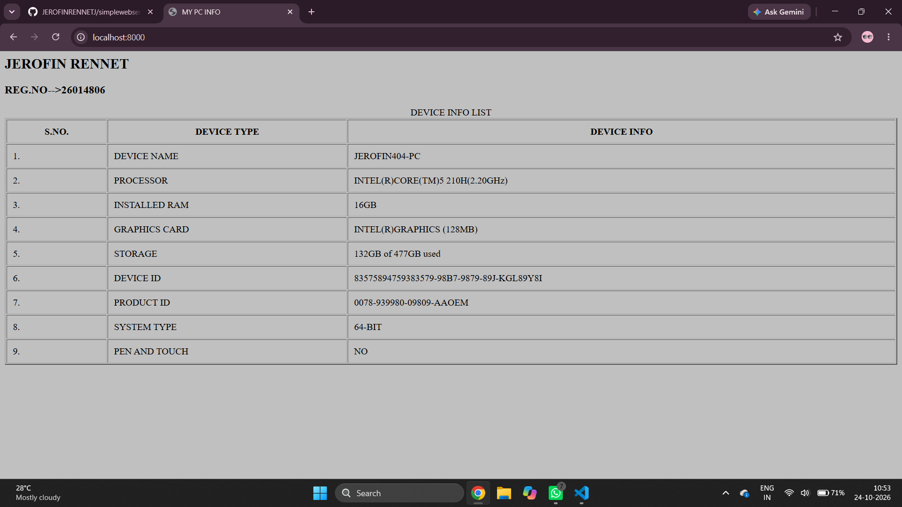
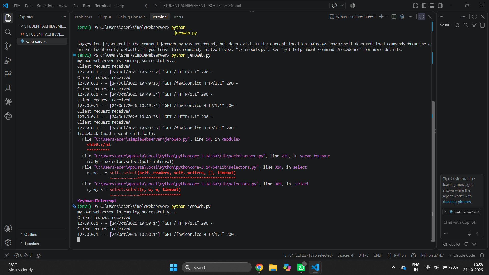

# EX01 Developing a Simple Webserver
## Date:28-09-2026

## AIM:
To develop a simple webserver to serve html pages and display the Windows Specifications of your Laptop.

## DESIGN STEPS:
### Step 1: 
HTML content creation.

### Step 2:
Design of webserver workflow.

### Step 3:
Implementation using Python code.

### Step 4:
Import the necessary modules.

### Step 5:
Define a custom request handler.

### Step 6:
Start an HTTP server on a specific port.

### Step 7:
Run the Python script to serve web pages.

### Step 8:
Serve the HTML pages.

### Step 9:
Start the server script and check for errors.

### Step 10:
Open a browser and navigate to http://127.0.0.1:8000 (or the assigned port).

## PROGRAM:
```
jeroweb.py
from http.server import HTTPServer, BaseHTTPRequestHandler
content = """
<html>
    <head>
        <title>MY PC INFO</title>   
    </head>
   
    <body bgcolor="silver">
        <h2>JEROFIN RENNET</h2>
        <h3>REG.NO-->26014806</h3>
        <table border="2" cellpadding="10" cellspacing="2" width="100%">
           <caption>DEVICE INFO LIST</caption>
        <tr>
           <th>S.NO.</th>
           <th>DEVICE TYPE</th>
           <th>DEVICE INFO</th>
        </tr>
        <tr>
           <td>1.</td>
           <td>DEVICE NAME</td>
           <td>JEROFIN404-PC</td>
        </tr>
        <tr>
           <td>2.</td>
           <td>PROCESSOR</td>
           <td>INTEL(R)CORE(TM)5 210H(2.20GHz)</td>
        </tr>
        <tr>
           <td>3.</td>
           <td>INSTALLED RAM</td>
           <td>16GB</td>
        </tr>
        <tr>
           <td>4.</td>
           <td>GRAPHICS CARD</td>
           <td>INTEL(R)GRAPHICS (128MB)</td>
        </tr>
        <tr>
           <td>5.</td>
           <td>STORAGE</td>
           <td>132GB of 477GB used</td>
        </tr>
        <tr>
           <td>6.</td>
           <td>DEVICE ID</td>
           <td>83575894759383579-98B7-9879-89J-KGL89Y8I</td>
        </tr>
        <tr>
           <td>7.</td>
           <td>PRODUCT ID</td>
           <td>0078-939980-09809-AAOEM</td>
        </tr>
        <tr>
           <td>8.</td>
           <td>SYSTEM TYPE </td>
           <td>64-BIT</td>
        </tr>
        <tr>
           <td>9.</td>
           <td>PEN AND TOUCH</td>
           <td>NO</td>
        </tr>


        </table>
    
    </body>
     
</html>
   
"""
class myhandler(BaseHTTPRequestHandler):
    def do_GET(self):
        print("Client request received")
        self.send_response(200)
        self.send_header('content-type', 'text/html; charset=utf-8')
        self.end_headers()
        self.wfile.write(content.encode())
server_address = ('',8000)
httpd = HTTPServer(server_address,myhandler)
print("my own webserver is running successfully...")
httpd.serve_forever()
```


## OUTPUT:
Webpage


server page


## RESULT:
The program for implementing simple webserver is executed successfully.
